# PART 1. Ubuntu 20.04 Server LTS o’rnatildi, versiya tekshiruvi: 
_cat /etc/issue_  
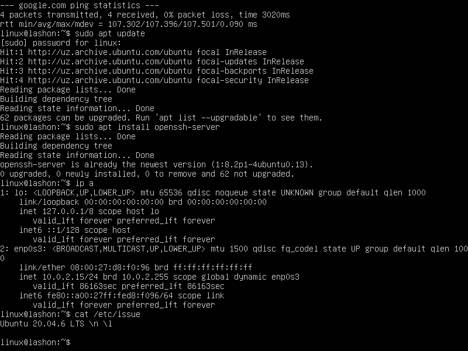 
# PART 2. User yaratish. (newuser)ni adm guruhiga qo’shish. 
_sudo adduser newuser_  
_sudo usermod -aG adm newuser_  
_cat /etc/passwd | grep newuser_  
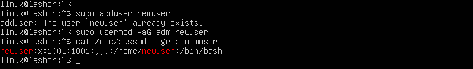 
# PART 3. OS networkni o’rnatish 
_1. Hostname o'zgartirish_  
_sudo hostnamectl set-hostname user-1_ 

_2. Timezone sozlash_  
_sudo timedatectl set-timezone Asia/Tashkent_ 

_3. Network interfeyslar_  
_ip a      yoki      ip link_ 

_4. DHCP orqali IP olish (lo interfeysi bu localhost uchun)_  
_ip a | grep inet_ 

_5. Gateway IP aniqlash_  
_ip route | grep default_ 

_6. External IP aniqlash (masalan wget yordamida)_  
_curl ifconfig.me_ 

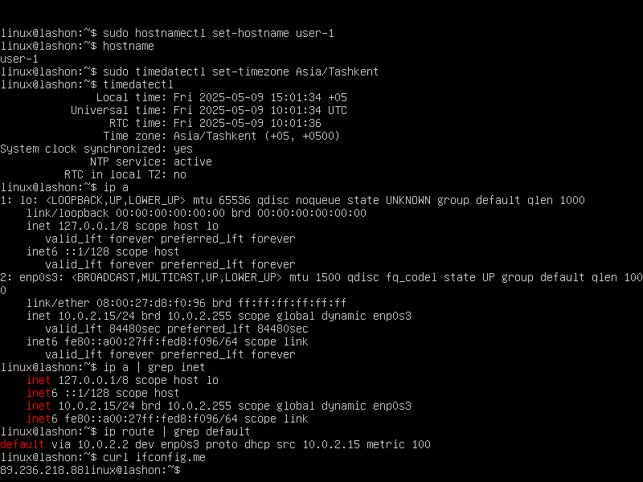 
_7. Netplan orqali statik IP sozlash:_  
_sudo nano /etc/netplan/00-installer-config.yaml_  
_Ichida quyidagidek yoziladi:_  
_(IP va gateway ni o'zingizga moslab belgilang)network:_  
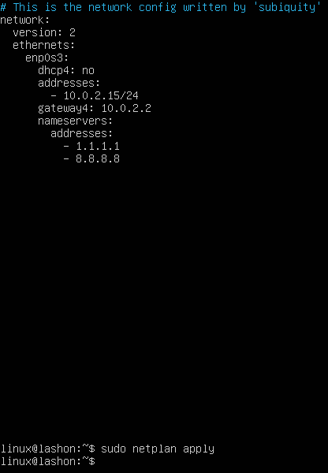 
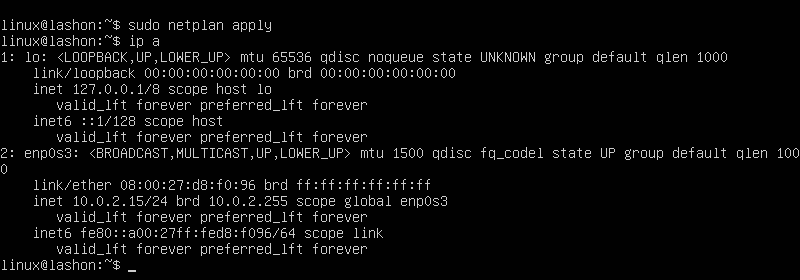 
_ctrl+o keyin enter keyin ctrl+x keyin quyudagi komand=> sudo netplan apply_ 

_8. Ping bilan tekshirish_  
_ping -c 4 1.1.1.1_  
_ping -c 4 ya.ru_  
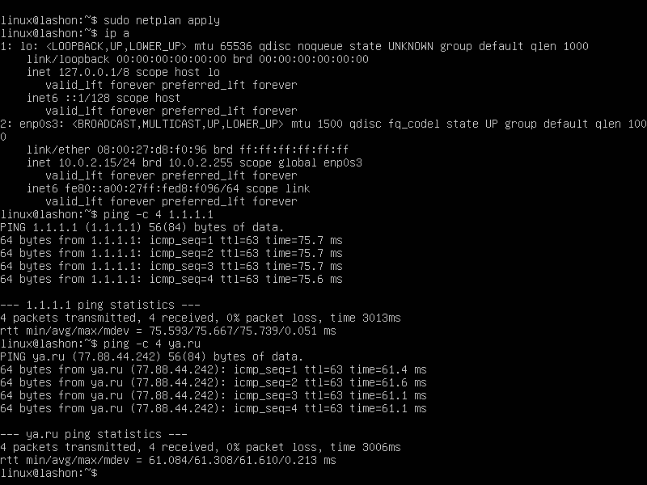 
# PART 4. Sistemani yangilash kerak, oxirida yana yangilash deganda yangilash yo’q deb chiqishi kerak. 
_sudo apt update_  
_sudo apt upgrade -y_  
_sudo apt update_  
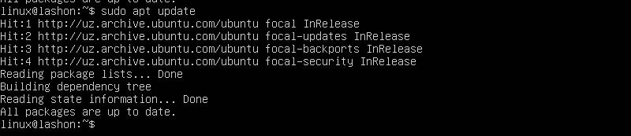 
# PART 5. Using the sudo command 
_sudo (SuperUser DO) buyrug‘i – oddiy foydalanuvchiga administrator (ya'ni root) huquqlari bilan vaqtincha buyruq bajarish imkonini beradi. Bu xavfsizlik va nazorat uchun muhimdir – foydalanuvchi doimiy root bo‘lishiga hojat yo‘q, lekin kerakli paytda muhim amallarni bajara oladi (masalan, konfiguratsiya fayllarini tahrirlash, xizmatlarni ishga tushirish, paket o‘rnatish va hokazo)._  
_Men newuser foydalanuvchisiga sudo vakolati berdim. sudo buyrug‘i Linux tizimida administrator vakolatlari bilan vaqtinchalik buyruq bajarish imkonini beradi. newuser foydalanuvchisi o’tish orqali tizim nomini user-new ga o‘zgartirdim va bu o‘zgarishlarni hostname komandasi orqali tekshirdim._  
_sudo usermod -aG sudo newuser - >  newuser ga sudo huquqini beradi_  
_sudo passwd newuser - >  newuserga parol o’rnatadi_  
_su – newuser  - >  tizimga newuser sifatida kiradi_  
_sudo hostnamectl set-hostname user-new - > hostname ni_  
_user-new ga o’zgartiradi_  
_hostname - > hostnameni ko’rish_  
_sudo apt update_  
_sudo apt update_  
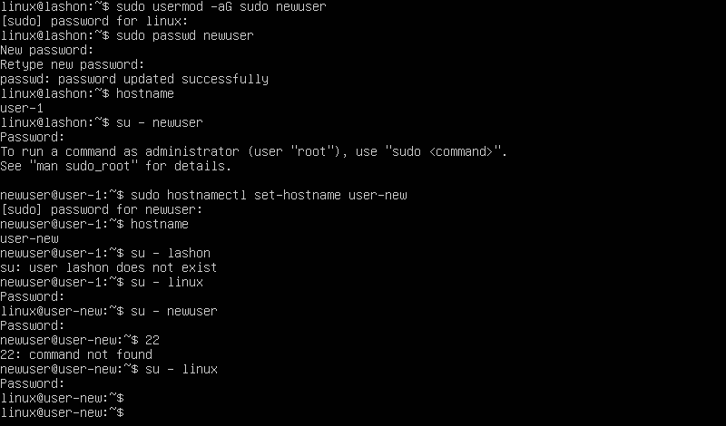 
# PART 6. Vaqt xizmatlarini o’rnatish va sozlash 
_sudo sudo timedatectl set-ntp true   - >  Ubuntu tizimida avtomatik vaqtni sinxronlash uchun systemd-timesyncd yoki chrony kabi xizmatlarni o‘rnatish mumkin. Quyidagi buyruqlar orqali systemd-timesyncd xizmatini faollashtiramiz_  
_timedatectl set-timezone Asia/Tashkent  - >  joriy zonani sozlash_  
_timedatectl show - > vaqtni tekshirish_  
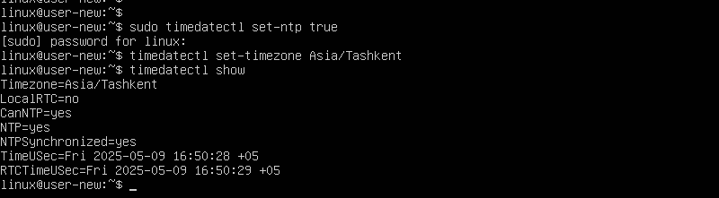 
# PART 7. Matn muharrirlarini o’rnatish va ulardan foydalanish 
VIM ning birinchi versiyasi 1991- yil 2 -noyabrda Niderlandiyada Barm Molenar chiqargan. 
_**File muharrirlarini o’rnatish** 
sudo apt update 
sudo apt install vim nano joe -y

**Har bir tahrirlovchida fayl yaratish saqlash:** 
**Vimda** - vim test_vim.txt 
nikname yoziladi 
Esc bosiladi, :wq  yozilib Enter bosiladi. 
**Nano** – nano test_nano.txt 
nikname yoziladi 
Ctrl+O bosiladi va Enter keyin Ctrl+X 
**Joe** – joe test_joe.txt 
nikname yoziladi 
Ctrl+K so’ng Ctrl+X va Enter_  
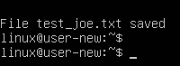 
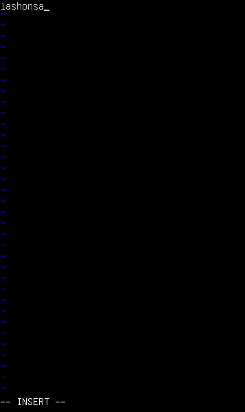 
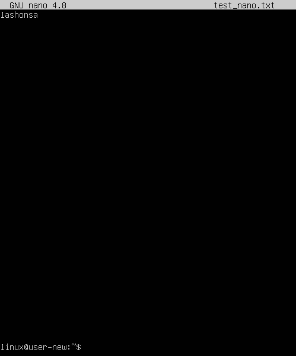 
_**matn muharririda o’zgartir lekin saqlamasdan chiqib ket** 
**Vim**  vim test_vim.txt  - > i bosiladi insert rejimga o’tish uchun,  
o’zgartiriladi, Esc tugmasi, :q! , keyin Enter_  
 
_**Nano**  nano test_nano.txt 
o’zgartiramiz, Ctrl+X, N bosiladi._  
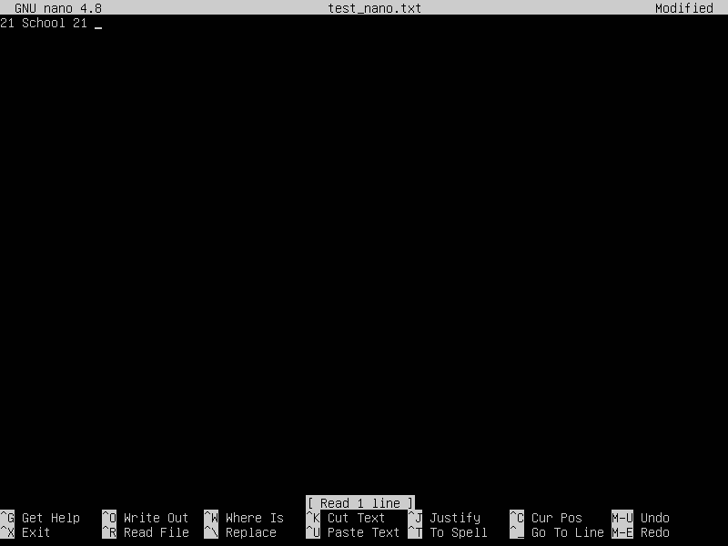 
_**Joe**  joe test_joe.txt 
o’zgartiramiz, Ctrl+C, keyin y bosiladi._  
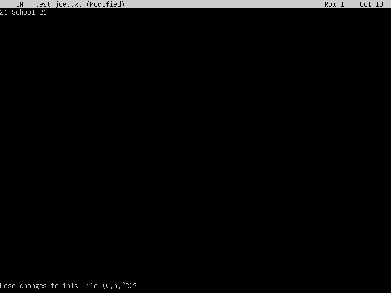 
_**Har bir muharrirda so’zlarni qidirish va almashtirish: 
Vim**   vim test_vim.txt 
/nickname → Enter 
:%s/nickname/user/g  → Enter 
:wq → Enter_  
 
 
_**Nano**    nano test_nano.txt 
Ctrl+W , keyin nickname, keyin Enter 
Ctrl+\ , keyin nickname → Enter, user → Enter 
Ctrl+o → Enter → Ctrl+X_  
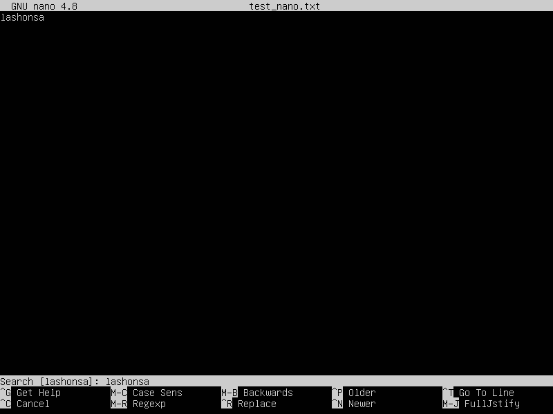 
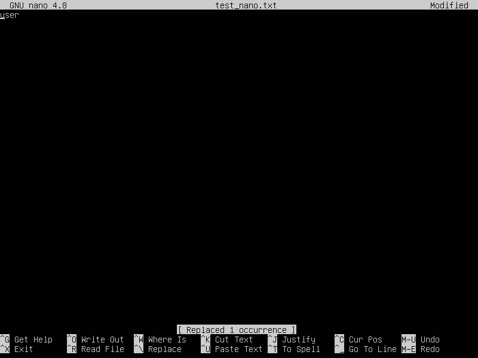 
_**Joe**    joe test_joe.txt 
Ctrl+K →  Enter → nickname  → R → user → Enter → Y →_  
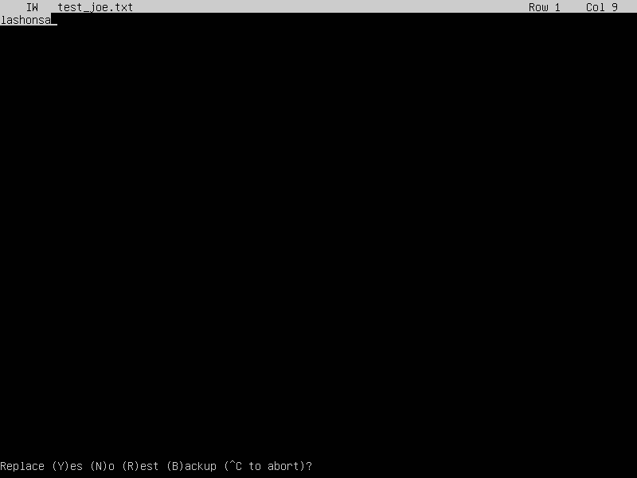 
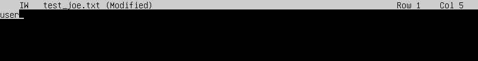 
# PART 8. SSHD xizmatini o’rnatish va asosiy konfiguratsiyasi 
_SSHD paketni o’rnatish 
sudo apt update 
sudo apt install openssh-server -y

xizmatni avtomatik ishga tushurishga sozlash 
sudo systemctl enable ssh 
sudo systemctl start ssh

portni 2022ga o’zgartirish 
sudo sed -i 's/#Port 22/Port 2022/' /etc/ssh/sshd_config 
sudo systemctl restart ssh

sshd jarayonini ps bilan tekshirish(ps – jarayonlarni korsatadi; aux – barcha foydalanuvchilar; grep [s]shd – natijada sshd jarayonini ajratib korsatish) 
ps aux | grep [s]shd

tizimni qayta yuklash 
sudo reboot

agar netstat bolmasa o’rnatish 
sudo apt install net-tools -y

netstatdan natijani ko’rsatish 
netstat -tan | grep ':2022'_  
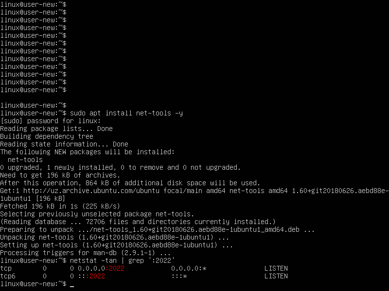 
_“-t”: TCP portlar; “-a”: barcha portlar; “-n”: raqamli format (DNSga murojaat yo‘q)._  
# PART 9. top, htop utilitalarini o’rnatish va ishlatish 
_sudo apt update sudo apt install htop -y     odatda o’rnatilgan bo’ladi top -n 1     → top ni ishga tushurish_  
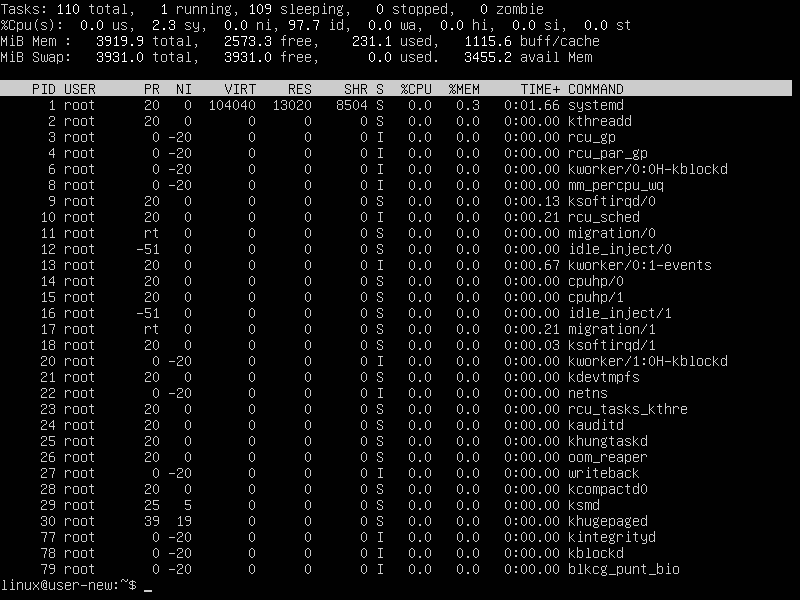 
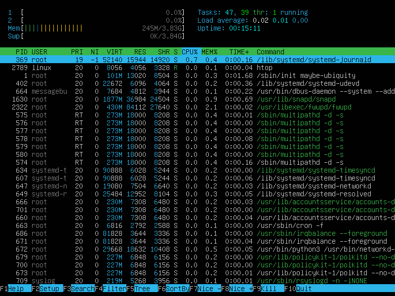
# PART 10. fdisk utilitasidan foydalanish 
_sudo fdisk -l 
qattiq disk nomi:  /dev/mapper/ubuntu--vg-ubuntu--lv 
hajmi(capacity):   23.102 GiB 
sektorlar soni:    50323456_  
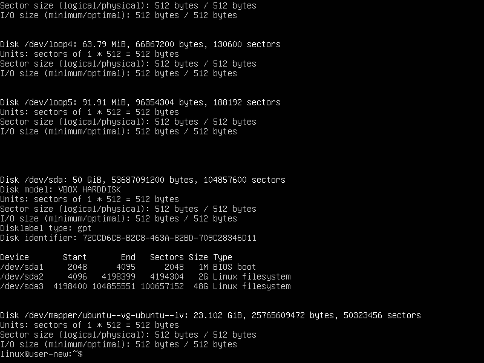 
# PART 11. df utilitasidan foydalanish disk maydoni haqida ma’lumot olish 
_df / 
bo’lim hajmi: 24590672 
band joy hajmi: 6864696 
bo’sh joy hajmi: 16451508 
foydalanish foizi: 30% 
df -Th/ 
bo’lim hajmi: 24G 
band joy hajmi: 6.6G 
bo’sh joy hajmi: 16G 
foydalanish foizi: 30%_   
# PART 12. du utilitasidan foydalanish disk maydoni haqida ma’lumot olish 
_du /home /var /var/log_ 
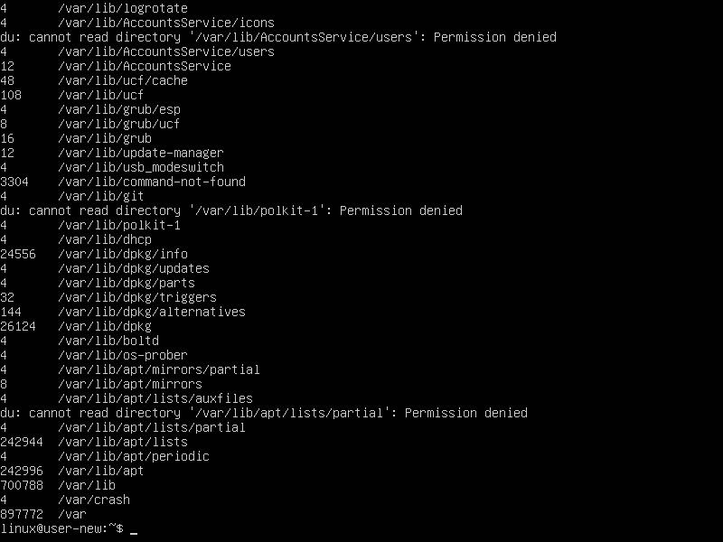 
_du -h /home /var /var/log_ 
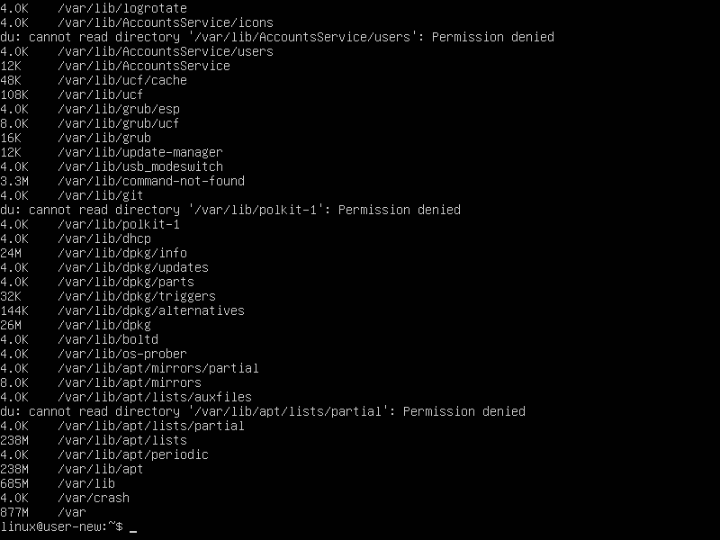 
_du -h /var/log/*_ 
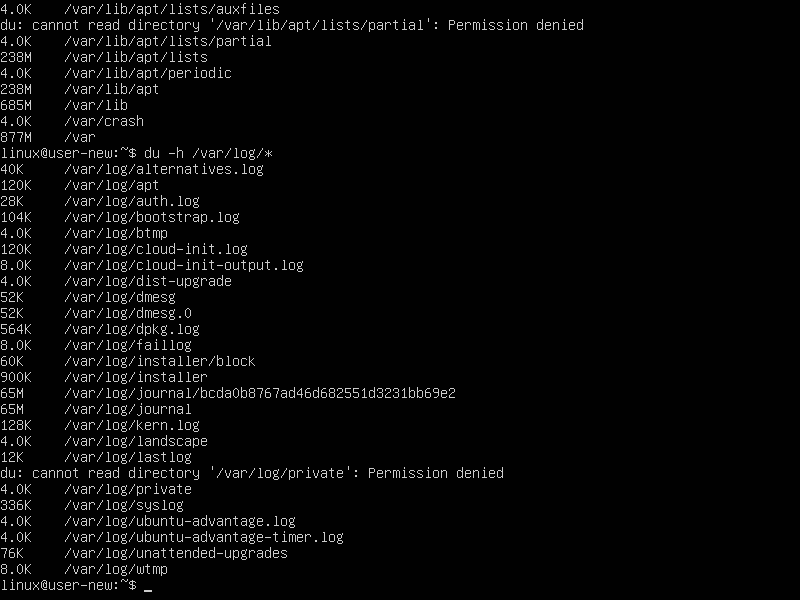 
# PART 13. ncdu utilitalarini o’rnatish va foydalanish 
_ncdu (NCurses Disk Usage) — bu diskdagi fayllar va papkalar qancha joy egallaganini interaktiv tarzda ko‘rsatadigan terminal dasturi. U du (disk usage) buyrug‘ining qulayroq, ko‘rgazmali interfeysga ega versiyasidir. /var/log/dmesg_  
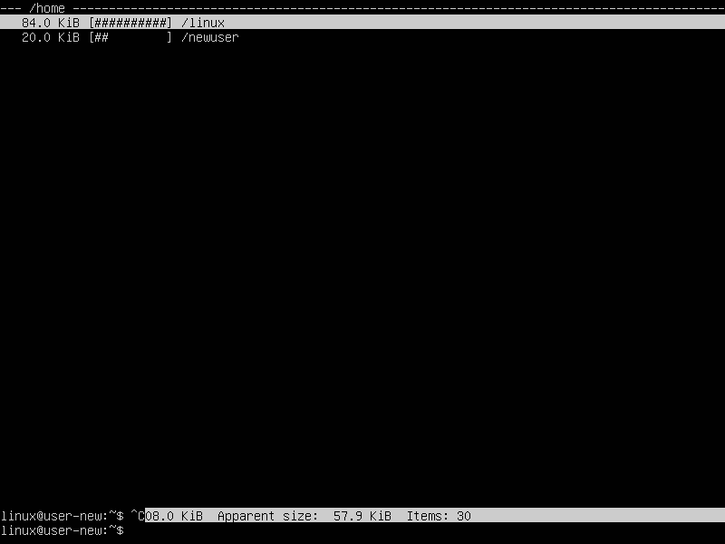 
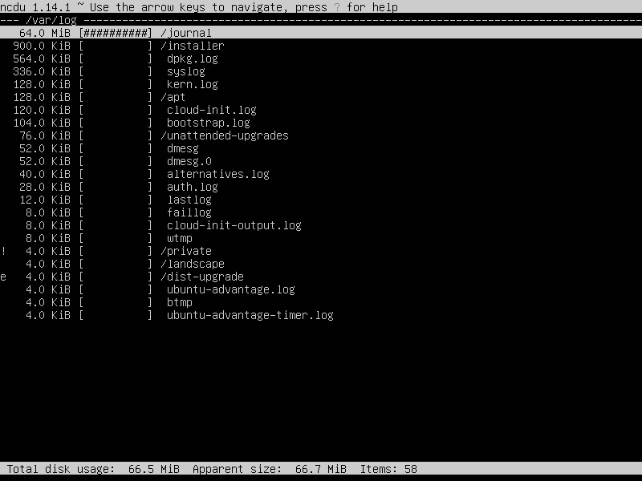 
# PART 14. Tizimli jurnallar bilan ishlash 
_sudo systemctl restart ssh 
grep 'sshd' /var/log/syslog_  
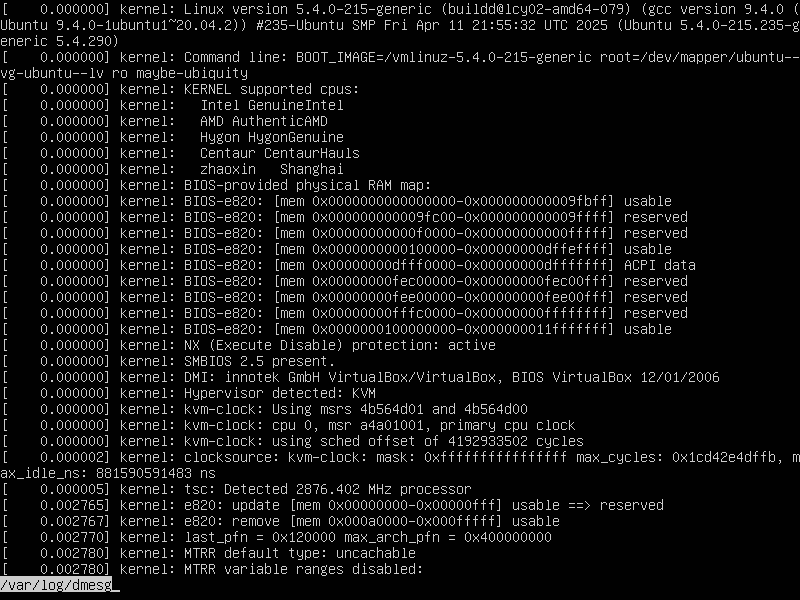 
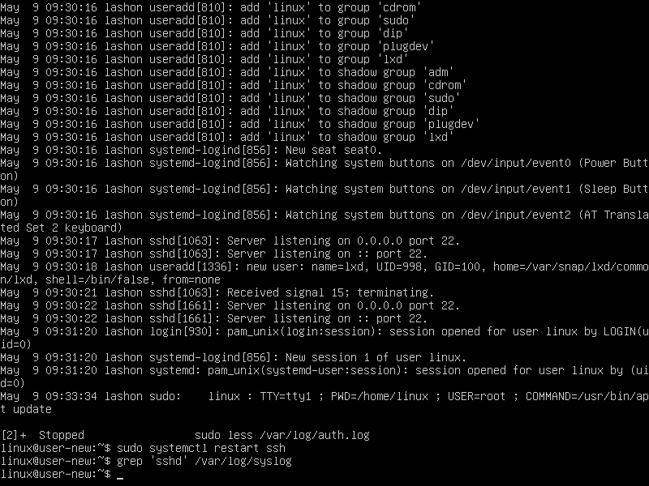 
# PART 15. CRON rejalashtiruvchisidan foydalanish 
_uptime buyrugini har 2 daqiqada ishlatish 
(crontab -l 2>/dev/null; echo "*/2 * * * * /usr/bin/uptime >> /var/log/uptime.log") | crontab -

loglardagi CRON ijro chiziqlarini topish 
grep CRON /var/log/syslog | tail -n 10_  
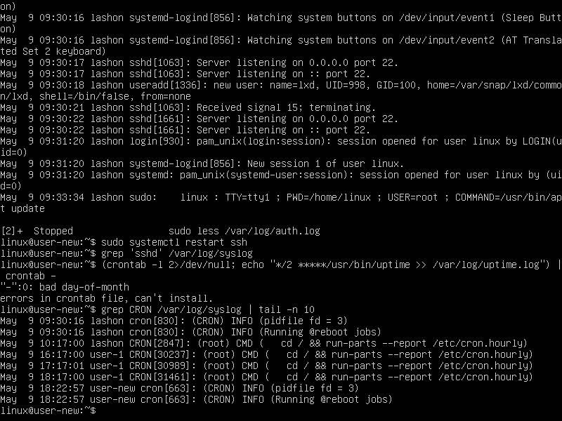 
_joriy CRON vazifalarini ko’rish 
crontab -l_ 
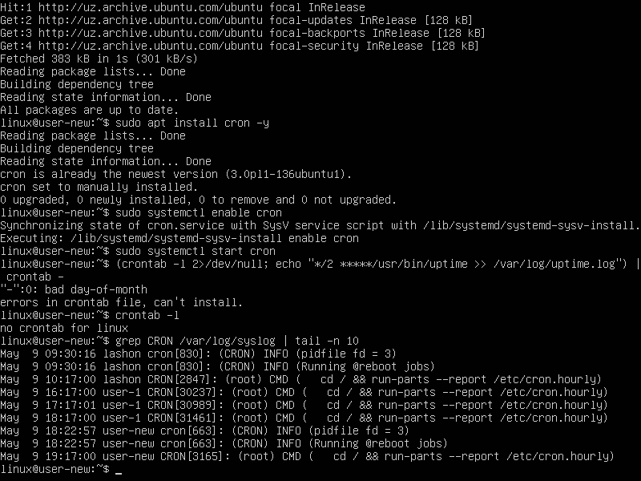 